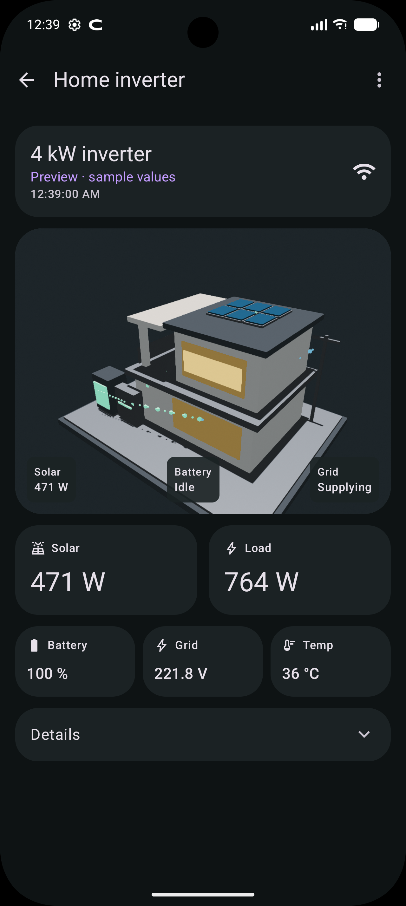
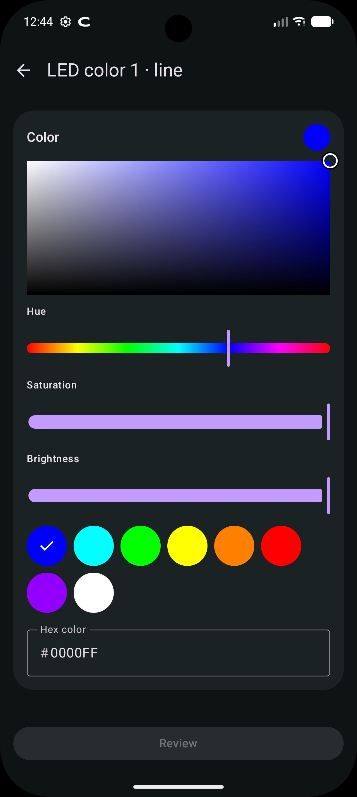
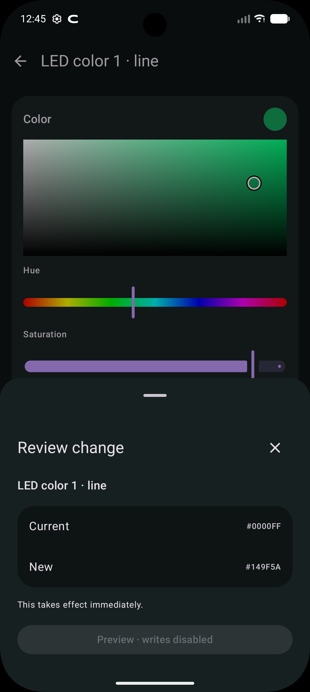

# Inverter Link · Android

Native Kotlin / Jetpack Compose inverter monitoring and control over local Wi-Fi. Material 3 Expressive UI, Filament 3D solar house and no cloud account, credentials or analytics.

Functionality is ported from [Inverter Link for iOS](https://github.com/talhabalaj/inverter-link), baseline `6458b22` / build `20261013.9`. The Android app uses Android navigation, controls and notifications.

## Companion apps

| Platform | Repository | Native UI |
| --- | --- | --- |
| Android | [Inverter Link for Android](https://github.com/talhabalaj/inverter-link-android) | Jetpack Compose / Material 3 Expressive |
| iOS | [Inverter Link](https://github.com/talhabalaj/inverter-link) | SwiftUI / RealityKit |

Both apps implement the same local PI30 functionality and 37-setting map, with platform-specific controls and background behavior. [Download the signed Android APK](https://github.com/talhabalaj/inverter-link-android/releases/tag/v0.1.0).

## Before using it

> [!WARNING]
> **This app can change real inverter settings.** Charging, battery voltage limits, AC output, alarms and recovery behavior can take effect immediately. Start with monitoring. Use the inverter and battery manufacturers’ specifications.

> [!WARNING]
> **Wrong battery values can interrupt power or damage the battery.** Command validation checks documented formats and limits; it cannot decide what is appropriate for your battery or wiring.

> [!WARNING]
> **Local mode may pause Energy Mate cloud reporting.** Discovery and connection request callbacks to this phone on TCP 8899. Restoring the previous cloud destination automatically has not been verified.

> [!WARNING]
> **The logger’s local protocol has no authentication or encryption.** Use a trusted LAN. Do not expose the logger or TCP 8899 to the internet. Treat devices that can reach the logger as able to control the inverter. **[Read the security setup guide](SECURITY.md) before connecting.**

Compatibility is based on a SolarMax-branded 4 kW / 24 V inverter using an Eybond / Energy Mate logger and the verified PI30 layout. White-label branding alone does not establish compatibility. The app rejects other protocol IDs and unsupported status layouts. The settings map and battery limits are specific to the verified 24 V layout.

Only LED color 1 has been physically changed and checked using the original iOS/local implementation. Android setting writes and the other setting commands still require physical validation. ACK without matching readback is an error; writes are never retried automatically. If verification is interrupted, check the inverter display before retrying. Factory reset, data erasure, AC2 schedules and maximum discharge-current settings are not exposed because they are outside the verified implementation.

## Features

- **Devices:** Connected, Saved and Discovered groups. Bounded Wi-Fi scanning, manual private IPv4/hostname, saved names, rename, forget and default selection. Scanning excludes the active logger.
- **Dashboard:** Interactive 3D house with rotation/zoom, energy particles, battery fill, solar/load/battery/grid/temperature readings, mode and latest reading timestamp. No bottom navigation inside a device.
- **Details:** All measurements, firmware, inverter settings and diagnostics.
- **37 settings:** Output, Battery, General and LED. Same command prefixes, options, units, limits and unavailable states as iOS. Battery warnings, invalid/no-op input rejection, separate review sheet, ACK and readback verification.
- **Color picker:** Hue/saturation/brightness, eight presets, preview and six-digit RGB hex input. All edit the same draft. Choosing a color does not send a command.
- **App settings:** Refresh intervals 5/10/15/30/60 seconds, six accent colors, default-inverter launch (off initially) and live-status notification.
- **Diagnostics:** The same 11 fixed PI30 queries and selectable raw responses.

Names and preferences are stored with DataStore on the phone. Reading history is not persisted, cloud credentials are not collected, and backups/device-transfer copies of app data are disabled.

## Install and connect

Android **10 / API 29 or newer**. Install the signed APK provided with the project, join the inverter Wi-Fi and launch Inverter Link. Use Scan or `+` to connect by address. Permit Local Network access on Android 17+ when asked. Permit notifications if enabling live status.

The phone must have a private Wi-Fi IPv4 address and be reachable from the logger. Guest isolation, VPN routing and another app listening on TCP 8899 can prevent callbacks. Discovery scans the containing `/24` or smaller subnet with at most 24 concurrent UDP probes. Use manual entry on larger networks. Saved-device reconnect tries hostname, last IP and identity-checked discovery candidates.

## Background and notification behavior

Monitoring pauses when the app is backgrounded. The notification keeps the last values and timestamp and marks them **Paused**. Returning to an open device dashboard reconnects. This is not an always-on background collector.

Live status uses a regular Android notification, requesting Live Update promotion on supported devices during active monitoring. Android/OEM eligibility and user settings determine promotion; the notification remains usable without it. There is no promise of an iOS Dynamic Island equivalent.

The house uses real geometry and an original procedural GLB. Battery watts are an estimate from net battery current × voltage. Grid watts and energy history are not inferred. Particle speed is decorative; disabling system animations hides the particles.

## Build

Install JDK 21 and Android SDK platform **37.0**, then:

```sh
git clone https://github.com/talhabalaj/inverter-link-android.git
cd inverter-link-android
sdkmanager 'platforms;android-37.0' 'build-tools;36.0.0'
# Configure ANDROID_HOME, or put sdk.dir in an untracked local.properties.
./gradlew testDebugUnitTest lintDebug assembleDebug assembleRelease
```

Pinned tools: Gradle 9.6.1, AGP 9.4.1, Compose compiler plugin 2.4.21, Material 3 **1.5.0-beta01**, Compose BOM 2026.09.00 and Filament 1.77.3. Expressive uses Google’s beta artifact; dependency upgrades are intentional rather than floating.

`app/build/outputs/apk/debug/app-debug.apk` is installable and debug-signed. Release output is unsigned until signed with your own key. Signing keys, passwords, SDK paths and build outputs are excluded from Git. GitHub Actions runs tests, lint and both builds and uploads the debug APK and reports.

To regenerate the house asset: `python3 tools/generate_house.py`.

## UI preview

The DEBUG APK offers an explicitly labeled preview with isolated preferences and no network discovery, connection or writes:

```sh
adb shell am force-stop me.balaj.inverterlink
adb shell am start -n me.balaj.inverterlink/.MainActivity --ez preview true
```

Preview Apply is disabled. Release ignores the preview extra. To return to normal mode, force-stop and launch without that extra.

## Screenshots

Labeled emulator preview data; no live writes.

  

## Verification

See [VALIDATION.md](VALIDATION.md) for tests, screenshots, the parity checklist and physical-device gaps. Tests use recorded response fixtures and mock loopback loggers. They do not write to a physical inverter.

## References and credits

- [Material 3 Expressive](https://developer.android.com/develop/ui/compose/designsystems/material3)
- [Android local-network permissions](https://developer.android.com/privacy-and-security/local-network-permission)
- [Live Update notifications](https://developer.android.com/develop/ui/views/notifications/live-update)
- [Google Filament](https://github.com/google/filament)
- [MAX / PI30 protocol reference](https://www.photovoltaikforum.com/core/attachment/232702-max-communication-protocol20210217-pdf/)
- Material Symbols vector paths from [Google Material Design Icons](https://github.com/google/material-design-icons), Apache 2.0. Filament is Apache 2.0. AndroidX is Apache 2.0. The house generator and Kotlin port are original project source.
